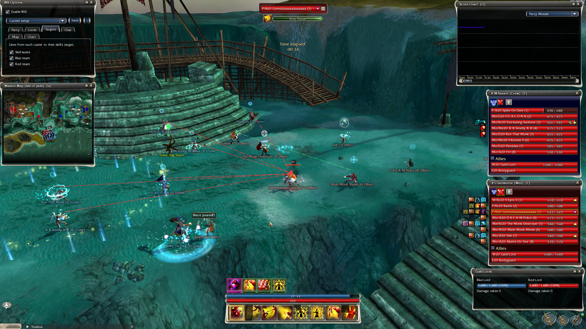
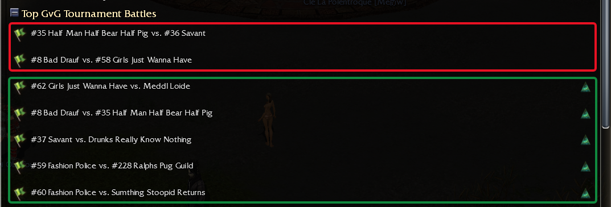
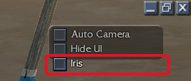

# Iris

**More insight. Right inside Guild Wars.**

Iris is a module for [GWToolbox++](https://www.gwtoolbox.com) that brings extra match information directly into
Guild Wars Observer Mode. Enjoy watching matches in game? Iris adds HUD panels that help you follow the action,
without needing to open GW Observer.

## How it works

GW Observer records matches. Iris uses data from those recordings and synchronizes it with the match you're
observing inside Guild Wars. When recording data is available for your match, Iris can display additional
information about players, skills, energy and effects alongside the action.

## What you need

- Guild Wars, watching a match in Observer Mode.
- The latest version of GWToolbox++.
- The Iris module: `Iris.dll` from this repository.
- Available GW Observer recording data for the synchronized match information.

You do not need to install or run GW Observer.

## Installation

Installing Iris has two parts: copy the file once, then load it once in GWToolbox++. After that it starts
by itself every time.

1. Make sure GWToolbox++ is up to date.
2. Close Guild Wars.
3. Download `Iris.dll` from the [latest release](https://github.com/MC92-hash/Gwtoolbox-Iris/releases/latest).
4. Put it in the `plugins` folder of your GWToolbox++ settings folder:
   `Documents\GWToolboxpp\<your computer name>\plugins\`.
5. Start Guild Wars with GWToolbox++. Open the GWToolbox++ **Settings**, go to **Plugins**, and click **Load**
   next to `Iris.dll`. GWToolbox++ remembers this: you only do it once.

## Using Iris

1. Open the **Observe** window in Guild Wars. Matches with an **Eye of Janthir** icon on the right have
   recording data, and Iris can show its HUD for them. Matches without the icon have no recording yet.

   

2. Watch one of those matches. In the top-right corner, under GW's own **Auto Camera** and **Hide UI**, tick
   **Iris** to open the IRIS Options window, where you choose which panels to show. Untick it, or close the
   window, to hide the options again; Iris keeps running.

   

## A note about accuracy

Energy values and effects shown by Iris are calculated from match events, rather than directly recorded. They may
contain errors or differ from the actual game state. Treat them as a guide, rather than exact values.

## Disclaimer

> [!WARNING]
> Plugins are not supported by ArenaNet, nor by the GWToolbox++ developers. Use Iris at your own risk.

---

Purif & Maverick
